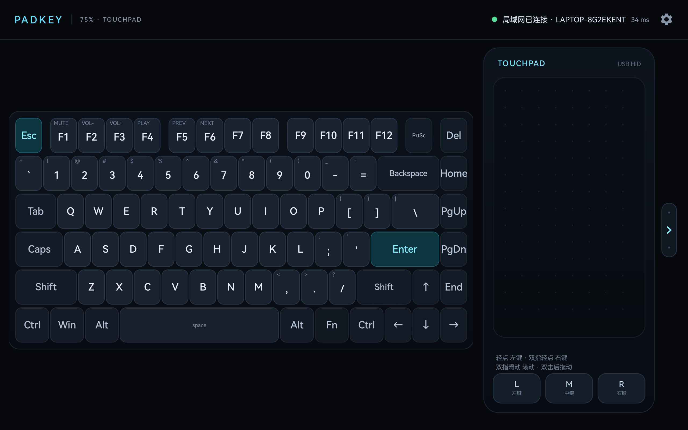
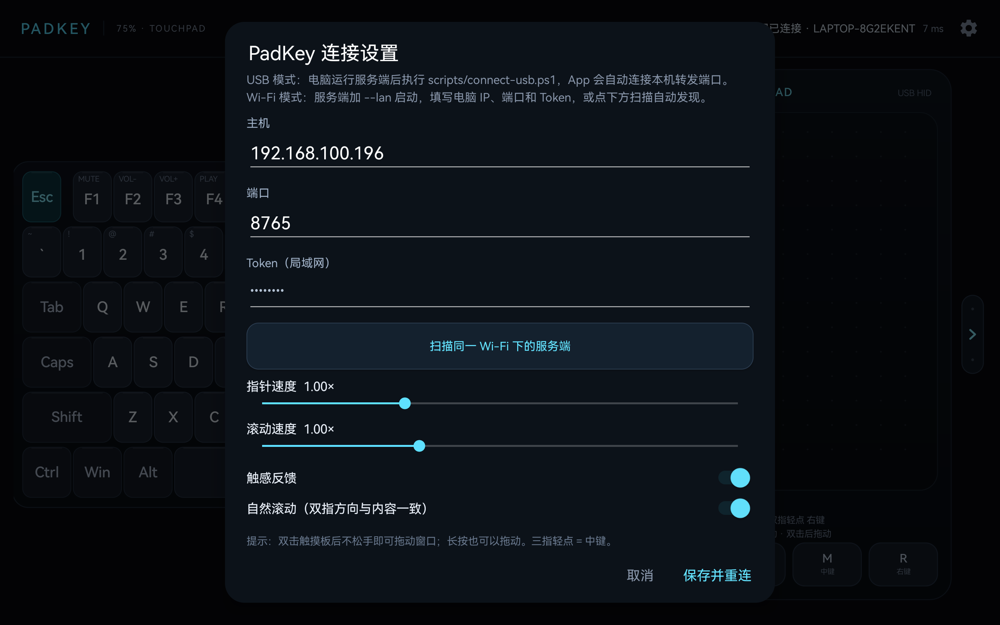

# PadKey · 把平板变成 75% 键盘 + 触摸板

PadKey 是一个 Windows ↔ Android 平板的输入桥接工具：

- **平板横屏**：左侧是 75% 配列键盘，右侧是带实体左右键的触摸板。
- **Windows 服务端**：通过 WebSocket 接收事件，用 Win32 <code>SendInput</code> 注入键盘和鼠标。
- **USB 优先**：默认只监听 <code>127.0.0.1</code>，通过 <code>adb reverse</code> 走数据线，不需要 Wi-Fi，也不向局域网暴露端口。
- **可选局域网**：服务端加 <code>--lan</code>，使用 Token 认证后可通过 Wi-Fi 连接。

已在 **HUAWEI MatePad 11（DBY-W09，Android 12，1600×2560）** 实机安装并验证：USB 连接、Wi-Fi 自动发现与连接、键盘注入、触摸板点击、底部 L/M/R 按键、触摸板侧边收起/展开均正常。

## 功能

### 外接蓝牙键盘

PadKey 支持把**已经配对到平板**的蓝牙键盘按键转发给电脑。它不会让平板直接变成
Windows 蓝牙 HID 键盘，也不需要额外的蓝牙权限：

1. 在 Android 设置 → 蓝牙中配对外接键盘
2. 打开 PadKey 右上角设置，确认 **“外接蓝牙键盘转发”** 已开启（默认开启）
3. 保持 PadKey 在前台，实体键盘按键会通过当前 USB/Wi-Fi 连接发给电脑

打开设置对话框时会暂停转发，方便在输入框里正常输入。音量、媒体键也会转发。
目前没有映射数字小键盘；不同键盘的 Fn 组合取决于 Android 上报的 keycode。

### 键盘
- 75% ANSI 布局：Esc / F1–F12 / PrtSc / Del，方向键与 Home/End/PgUp/PgDn 导航列。
- 真正的多指和弦：按住 Shift / Ctrl / Alt / Win 的同时可以按其他键。
- 按键按住会自动重复（服务端实现，不依赖 Android 输入法）。
- Fn 组合：Fn + F1–F6 = 静音 / 音量- / 音量+ / 播放暂停 / 上一首 / 下一首。
- 按下高亮、触感反馈，按下键的青色高亮与平板端状态一致。

### 触摸板

| 手势 | 动作 |
| --- | --- |
| 单指移动 | 移动鼠标 |
| 单指轻点 | 左键单击 |
| 双击后不松手拖动 | 拖拽（按住左键移动） |
| 长按后拖动 | 拖拽 |
| 双指滑动 | 滚轮滚动（可切换自然滚动） |
| 双指轻点 | 右键单击 |
| 三指轻点 | 中键单击 |
| 底部 L / M / R | 左键 / 中键 / 右键，按住可拖拽 |

- 触摸板右侧有细长把手：点一下收起触摸板，键盘自动展开占满宽度；再点一下恢复。收起状态会记住。
- 指针速度、滚动速度、触感、自然滚动都可以在右上角设置中调整。
- 触摸点有波纹反馈，拖拽 / 滚动状态会显示在触摸板右上角。

### 连接与安全
- 默认 USB 模式：服务端只绑定 <code>127.0.0.1</code>，平板通过 <code>adb reverse</code> 访问本机端口。
- 局域网模式：<code>--lan</code> 生成 Token，服务端校验 Token 后才接受控制。
- 客户端断开、切后台或服务端退出时，会释放所有按下的键和鼠标按键，避免“卡键”。
- 睡眠/唤醒恢复：App 有 7 秒心跳超时，会自动断开半开连接并重连；服务端会把超时的旧连接替换为新连接。
- 唤醒后第一次输入会主动调用 <code>SetThreadExecutionState</code> 唤醒显示器，减少“本机点一下才能用”的情况。
- 电脑锁屏且安全输入服务不可用时，App 会显示“已连接 · 电脑已锁屏”。
- 单设备模式：同时只允许一个平板控制，第二个连接会被拒绝。
- 外接蓝牙键盘：在 Android 设置中配对蓝牙键盘后，PadKey 可以把实体按键转发到电脑（设置里可关闭）。
- Wi-Fi 自动发现：服务端 <code>--lan</code> 启动时监听 UDP 8767，App 设置里可一键扫描同网段电脑并填入地址。

## 快速开始（Windows 10/11）

### 1. 启动电脑端

双击 <code>start-server.cmd</code>，或者：

    .\dist\PadKeyServer.exe

看到 <code>正在监听 ws://127.0.0.1:8765/</code> 即成功。首次启动会在
<code>%APPDATA%\PadKey\server.json</code> 生成配置。

### 2. 连接平板

1. 平板打开 **开发者选项 → USB 调试**。
2. 用数据线连接电脑，解锁平板，在“允许 USB 调试吗？”中勾选“始终允许”并点“允许”。
3. 在电脑运行：

    powershell -ExecutionPolicy Bypass -File .\scripts\connect-usb.ps1 -Install

脚本会：

- 检查 adb 和设备授权；
- 安装 <code>dist\PadKey.apk</code>（<code>-Install</code> 时，或检测到未安装时）；
- 执行 <code>adb reverse tcp:8765 tcp:8765</code>；
- 启动 PadKey，并传入 <code>127.0.0.1:8765</code>。

平板顶部状态变成绿色 **USB 已连接 · 电脑名** 即可使用。
如果先启动了 App、后启动服务端也没关系，App 会自动重连。

> 拔插数据线或重启平板后，<code>adb reverse</code> 会失效。重新执行一次
> <code>scripts\connect-usb.ps1</code> 即可。

### 3. 使用

- 直接点击左侧键盘；支持多指同时按。
- 在右侧触摸板移动手指控制鼠标。
- 右上角齿轮打开设置。

## 托盘运行与开机自启

服务端启动后会在系统托盘显示图标，右键菜单可以：

- 显示 / 隐藏控制台
- 最小化到托盘
- 开关开机自启
- 退出 PadKey Server

启动时直接进托盘、不弹控制台：

    .\start-server-tray.cmd

或：

    .\dist\PadKeyServer.exe --tray

只最小化控制台、保留任务栏窗口：

    .\dist\PadKeyServer.exe --minimized

### 开机自启

设置当前用户登录后自动在托盘运行：

    powershell -ExecutionPolicy Bypass -File .\scripts\install-autostart.ps1

等价于：

    .\dist\PadKeyServer.exe --install-autostart

取消：

    powershell -ExecutionPolicy Bypass -File .\scripts\uninstall-autostart.ps1

查看状态：

    .\dist\PadKeyServer.exe --autostart-status

执行安装后，自启使用隐藏启动器，避免登录时闪出命令行窗口：

    HKCU\Software\Microsoft\Windows\CurrentVersion\Run\PadKeyServer
    = wscript.exe "%APPDATA%\PadKey\start-tray.vbs"

<code>start-tray.vbs</code> 会以最小化窗口启动 <code>PadKeyServer.exe --tray</code>，
服务端初始化托盘后再隐藏控制台。若托盘初始化失败，控制台会保留为任务栏最小化窗口，
可以手动恢复，不会出现一个完全看不见的后台进程。

> 如果移动了项目目录，重新执行一次安装脚本即可更新路径。
> 自启会读取 <code>%APPDATA%\PadKey\server.json</code> 中保存的模式：先用 <code>--lan</code> 启动过一次，之后自启就是局域网模式；用 <code>--usb</code> 启动过则回到 USB 模式。

## 局域网模式（可选）

    .\dist\PadKeyServer.exe --lan --port 8765

服务端会打印一个 Token，例如：

    Token: 3F9A2C71

在平板设置里填写：

- 主机：电脑的局域网 IPv4（例如 <code>192.168.1.23</code>）
- 端口：<code>8765</code>
- Token：上面显示的 Token

Windows 防火墙需要放行 TCP 8765（控制）和 UDP 8767（发现）：

    New-NetFirewallRule -DisplayName "PadKey 8765" -Direction Inbound -Protocol TCP -LocalPort 8765 -Action Allow
    New-NetFirewallRule -DisplayName "PadKey Discovery" -Direction Inbound -Protocol UDP -LocalPort 8767 -Action Allow

启动 <code>--lan</code> 后，在平板设置里点 **“扫描同一 Wi-Fi 下的服务端”**，选择电脑即可自动填入主机和端口；再输入电脑控制台显示的 Token。

切回 USB 模式：

    .\dist\PadKeyServer.exe --usb

> 局域网模式没有 TLS，Token 只能防止误连，不能防止同网段抓包。请只在可信网络使用；
> 日常推荐 USB 模式。

## 设置项

| 设置 | 说明 |
| --- | --- |
| 主机 / 端口 | USB 用 <code>127.0.0.1:8765</code>；Wi-Fi 填电脑 IP |
| Token | 仅局域网模式需要 |
| 指针速度 | 0.35×–2.50× |
| 滚动速度 | 0.4×–2.2× |
| 触感反馈 | 按键 / 点击振动 |
| 自然滚动 | 双指方向与内容移动方向一致 |

## 构建

### 环境
- Windows 10/11 x64
- .NET 10 SDK（服务端目标 <code>net10.0</code>）
- JDK 21
- Android SDK：platform 34、build-tools 34.0.0
- Gradle 8.9（已带 <code>gradlew</code>，首次联网下载）

### 一键构建

    powershell -ExecutionPolicy Bypass -File .\scripts\build.ps1

输出：

- <code>dist\PadKey.apk</code>
- <code>dist\PadKeyServer.exe</code>（单文件、自包含 .NET 运行时）

### 手动构建

    # Android
    cd .\android
    .\gradlew.bat :app:assembleRelease

    # Windows 服务端
    cd ..\server
    dotnet publish -c Release -r win-x64 --self-contained true -p:PublishSingleFile=true -p:IncludeNativeLibrariesForSelfExtract=true -o ..\dist

本项目没有第三方 Android 依赖，APK 只有约 120 KB；服务端也只使用 .NET BCL。

## 目录

    keypad/
    ├─ dist/                 发布产物（PadKey.apk / PadKeyServer.exe）
    ├─ android/              Android 工程（Java + 自定义 Canvas 视图）
    │  └─ app/src/main/java/com/padkey/app/
    │     ├─ MainActivity.java
    │     ├─ ConnectionManager.java   # 无依赖 RFC6455 WebSocket 客户端
    │     ├─ KeyboardView.java        # 75% 键盘与多指
    │     └─ TouchpadView.java        # 触摸板手势
    ├─ server/               .NET 控制台服务端
    │  ├─ PadServer.cs        # HTTP/WebSocket 服务
    │  ├─ ClientSession.cs    # 单设备状态、按键重复
    │  ├─ InputInjector.cs    # Win32 SendInput
    │  ├─ KeyMap.cs           # USB HID → Windows scan code
    │  └─ Config.cs
    ├─ scripts/              connect-usb / start-all / build / autostart
    ├─ docs/                 预览图
    └─ tools/                本地 adb / Android SDK（构建用，不分发）

## 协议

WebSocket 文本帧，JSON，HID 键盘 Usage ID：

    {"t":"hello","v":1,"token":"","name":"Xiaomi Pad"}
    {"t":"key","code":4,"down":true}
    {"t":"move","dx":12.4,"dy":-3.1}
    {"t":"button","b":"left","down":true}
    {"t":"scroll","dx":0,"dy":1}
    {"t":"ping","ts":123456}

服务端回 <code>welcome</code> / <code>pong</code>。USB 模式下 Token 可空；局域网模式必须匹配。

## 常见问题

**adb 显示 <code>unauthorized</code>**

平板没有允许这台电脑的调试密钥。解锁平板，重新插拔数据线，点“允许 USB 调试”。
仍不弹窗时：把 USB 模式改成“传输文件/MTP”，或在开发者选项里“撤销 USB 调试授权”后重试。

**App 显示未连接，但服务端已启动**

重新执行 <code>scripts\connect-usb.ps1</code>，它负责 <code>adb reverse</code>。也可手动：

    adb reverse tcp:8765 tcp:8765

**按键没有输入到某个程序**

如果目标程序以管理员权限运行，Windows 的 UIPI 会阻止普通权限进程注入。
右键 <code>PadKeyServer.exe</code> →“以管理员身份运行”，或使用 <code>start-all.ps1 -Admin</code>。

**键盘符号与键帽不一致**

服务端发送的是物理扫描码，Windows 会按当前键盘布局解释。如果你使用非 US 布局，
字母位置会跟随布局。把 Windows 布局设为“中文(简体) - 美式键盘”即可与键帽一致。

**唤醒后停在 PIN 锁屏，平板按键无效**

这是 Windows 安全桌面机制：锁屏 PIN 只能由物理键盘、Windows Hello 或远程桌面输入，
普通应用（即使以管理员运行）不能用 <code>SendInput</code> 向 Winlogon 安全桌面注入按键。

App v1.4.0 会在安全输入不可用时显示“已连接 · 电脑已锁屏”，避免误以为输入设备坏了。

如果这台电脑是个人使用、可以接受降低安全性，可关闭“唤醒后需要登录”：

    powershell -ExecutionPolicy Bypass -File .\scripts\disable-wake-lock.ps1

恢复：

    powershell -ExecutionPolicy Bypass -File .\scripts\restore-wake-lock.ps1

关闭后唤醒会直接回到桌面，PadKey 可以立即使用。但这意味着别人唤醒电脑也无需 PIN，
请根据使用环境决定。若必须保留 PIN，则需要在电脑上手动解锁，或使用 Windows 远程桌面。

**锁屏 PIN：可选安全输入服务（v1.3.0+）**

PadKey 可以安装一个可选的 LocalSystem 服务，在 Windows 的 Winlogon 安全桌面启动 helper，
从而在锁屏 PIN 界面输入数字、字母、退格和回车。原理与 Mouse without Borders 相同：

- 服务名：<code>PadKeySecure</code>，以 LocalSystem 自动启动
- 服务用 winlogon 进程令牌，在 <code>winsta0\winlogon</code> 桌面启动
  <code>PadKeyServer.exe --secure-helper</code>
- helper 通过本机命名管道 <code>PadKeySecureInput</code> 接收键盘、触摸板移动/点击/滚轮并 SendInput
- PadKeyServer 只在检测到**锁屏**时转发按键
- 默认只对 USB/loopback 转发；设置 `AllowLanUnlock` 后可允许受信任局域网输入 PIN
- 注意：LAN 模式是明文 `ws://` + Token，能嗅探/拿到 Token 的同网设备也能尝试输入 PIN；只应在可信 Wi-Fi 使用

安装（会弹 UAC）：

    powershell -ExecutionPolicy Bypass -File .\scripts\install-secure-service.ps1

卸载：

    powershell -ExecutionPolicy Bypass -File .\scripts\uninstall-secure-service.ps1

注意：这个服务拥有 SYSTEM 权限并运行在安全桌面，属于高权限组件。只应在自己的电脑上使用；
安装后请保持 PadKey 的 Token/配对安全。更新 PadKeyServer.exe 前需要先停止服务：

    Stop-Service PadKeySecure

否则服务会锁住 exe。卸载服务后，锁屏仍需物理键盘或 Windows Hello 解锁。

**休眠/唤醒按键**

标题栏右侧的电源按钮提供：

- **让电脑休眠**：通过 WebSocket 请求服务端调用 Windows 睡眠，App 会先弹出确认。
- **唤醒电脑**：发送 Wake-on-LAN 魔术包（UDP 9/7，广播到 255.255.255.255 和当前 /24 网段）。

唤醒需要：

- 电脑通过有线以太网连接，并在网卡高级设置中开启“魔术封包唤醒”
- BIOS/网卡开启 Wake-on-LAN
- 平板与电脑在同一局域网，且 App 至少成功连接过一次以缓存网卡 MAC
- 若使用“快速启动/关机”，部分网卡需要在 BIOS 中允许关机唤醒

App 会在欢迎消息后缓存电脑的网卡 MAC；未连接过的新平板无法直接唤醒。

**USB 已连接但 App 显示无法连接**

这通常是 Windows 重启、USB 重新枚举或休眠后 <code>adb reverse</code> 映射丢失。
PadKey 可以安装一个隐藏看护进程，每 5 秒检查并恢复 <code>adb reverse tcp:8765 tcp:8765</code>，
启动项为 <code>HKCU\...\Run\PadKeyUsbWatch</code>。

当前已停用 USB/ADB 看护，记录见 [docs/usb-adb-disabled.md](docs/usb-adb-disabled.md)。
重新开启：

    powershell -ExecutionPolicy Bypass -File .\scripts\install-usb-watch.ps1

手动恢复仍然可以运行：

    powershell -ExecutionPolicy Bypass -File .\scripts\connect-usb.ps1

停止看护：

    powershell -ExecutionPolicy Bypass -File .\scripts\uninstall-usb-watch.ps1

**唤醒后第一次输入没反应**

v1.4 起服务端在连接恢复或间隔一段时间后的第一次键鼠事件时会主动唤醒显示器。
如果仍然需要本机点击一次，通常是 Windows 锁屏画面还没被本机输入唤醒；这是系统锁屏行为。
请确认平板 PadKey 在前台，触摸板处于展开状态，再试一次。

**锁屏 PIN 界面触摸板不工作**

Windows 锁屏是安全桌面，键盘输入由 PadKeySecure 转发；鼠标在锁屏界面的支持取决于
Windows 版本和锁屏状态，部分系统会忽略注入的鼠标。键盘输入 PIN 仍是可靠路径。
另外触摸板如果被右侧把手收起，会完全不接收触摸事件，先点把手展开。

**电脑休眠/唤醒后连不上**

v1.2 起 App 会自动心跳重连，服务端会替换旧连接，通常唤醒后 10 秒内恢复。如果电脑换了 Wi-Fi IP，打开设置点“扫描同一 Wi-Fi 下的服务端”重新选择即可。

**第一次进入全屏出现 “Viewing full screen”**

这是 Android 的一次性沉浸式提示，点 <code>GOT IT</code> 即可；以后不会再出现。

**多台设备**

    .\scripts\connect-usb.ps1 -Serial <设备序列号>

## 已知限制

- 没有做手掌误触抑制；大触摸板长时间打字时建议手掌不要压到右侧。
- 不支持三指/四指滑动切换桌面等系统手势（仅轻点中键）。
- 局域网模式是明文 WebSocket，不建议在公共网络使用。
- APK 使用 debug 签名，仅适合个人安装；正式分发请换自己的签名。
- 权限受 Windows UIPI 限制，无法向管理员窗口注入，除非服务端也以管理员运行。

---

Made for a 75% layout on a tablet. 有问题先看“常见问题”，再检查服务端控制台日志。
